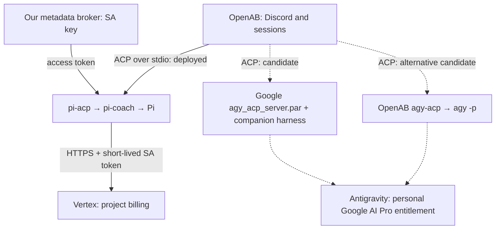

# Google AI subscriptions, Vertex, and ACP

Reviewed on **2026-10-25**. This is a source review and migration assessment,
not a deployment change or an authenticated subscription test. The deployed
versions and successful Vertex call come from the [same-day audit](audits/2026-10-25.md).
No account tokens, billing records, or private vault contents were inspected for
this review, and no model requests were made.

Upstream OpenAB was reviewed at
[`20830d5`](https://github.com/openabdev/openab/commit/20830d5dfb24cff96599001832164152a22bbb71).
The Antigravity ACP registry entry was reviewed at
[`06229c6`](https://github.com/agentclientprotocol/registry/blob/06229c691d24d039e2363ba12abe5c9dfae5bc66/antigravity-acp/agent.json).
Account eligibility and entitlements still need confirmation with the operator's
own account.

## Answer

The deployed coach already uses ACP. It calls Vertex from Pi, using a
service-account access token supplied by our broker. A personal **Google AI Pro
subscription**, a **Gemini Pro model**, and a **Gemini API key** are different
things; none can be substituted for another by changing an account name.

There are two ways the subscription could help:

- Keep Pi and Vertex, and redeem the subscription's eligible monthly Cloud
  credit against the billing account that pays for this project.
- Change the agent backend to Antigravity and authenticate with the subscribed
  personal account. Google now distributes an official ACP server; OpenAB also
  has its own, different `agy-acp` adapter. Neither path has been validated in
  this sandbox.

Gemini CLI itself supports native ACP, but individual subscription access through
Gemini CLI ended on June 18, 2026. Its protocol support does not restore that
account entitlement. [Google's deprecation notice](https://developers.google.com/gemini-code-assist/docs/deprecations/code-assist-individuals)
and [Gemini CLI ACP documentation](https://geminicli.com/docs/cli/acp-mode/)
establish those separate facts.

## Separate the four layers

| Layer | What it decides | What we use today |
|---|---|---|
| Chat bridge | Discord identity, threads, session routing | OpenAB 0.9.0 |
| Agent and local tools | Context discovery, file edits, shell commands, tool loop | Pi 0.84.2 through `pi-acp` 0.0.31 |
| Model service | Where inference runs and which model is selected | Vertex, `google-vertex/gemini-3.7-flash` |
| Authentication and billing | Which principal can call the service and who pays | Service account; GCP project billing |

ACP is the local JSON-RPC interface between the bridge and an agent. It is not
Google authentication, a model endpoint, or a subscription billing mechanism.
The model request still happens after the agent receives an ACP prompt.

Solid lines are the existing path; dotted lines are proposed alternatives.
Docker versus Kubernetes does not determine ACP availability. Both can run these
stdio processes; their isolation and supervision still need explicit settings.

## What changed upstream

| Date | Evidence | Consequence here |
|---|---|---|
| 2026-04-30 | [Pi v0.71.0](https://github.com/earendil-works/pi/releases/tag/v0.71.0) removed built-in Gemini CLI and Antigravity support | Our Pi 0.84.2 cannot regain Google subscription login through a configuration-only provider change |
| 2026-06-18 | [Google's announcement](https://github.com/google-gemini/gemini-cli/discussions/28017) stopped Gemini CLI requests for Free, AI Pro and AI Ultra individual accounts | The old personal-account Gemini CLI instructions no longer provide this route; API-key access was explicitly unaffected |
| 2026-10-09 | [Google's updated deprecation page](https://developers.google.com/gemini-code-assist/docs/deprecations/code-assist-individuals) confirms the individual-account change | Prefer this dated notice over generic authentication pages that still describe the older Pro login flow |
| 2026-10-23 | The reviewed [ACP registry revision](https://github.com/agentclientprotocol/registry/blob/06229c691d24d039e2363ba12abe5c9dfae5bc66/antigravity-acp/agent.json) lists Google's Antigravity ACP server 1.4.3 | Official ACP support exists separately from the `agy` terminal command |

The [Pi 0.84.2 provider documentation](https://github.com/earendil-works/pi/blob/v0.84.2/packages/coding-agent/docs/providers.md)
lists Google Gemini API-key access as provider `google`, and Vertex separately.
Its subscription list does not include either removed Google provider. An old
README or OAuth example mentioning `google-gemini-cli` is not evidence that the
deployed release supports it.

This history does **not** prove why the original author selected Vertex. The
repository documents the implemented Pi/Vertex path and subsequent hardening;
it does not contain a complete original comparison against consumer subscriptions.

## The available routes

### Keep Vertex and use the subscription's Cloud credit

Google's current [Developer Program plan table](https://developers.google.com/program/plans-and-pricing)
includes **$10 in monthly GenAI and Cloud credit with Google AI Pro**. Its
[benefit announcement](https://blog.google/innovation-and-ai/technology/developers-tools/gdp-premium-ai-pro-ultra/)
explicitly names Vertex AI among the supported uses.

This is a billing benefit, not unlimited API usage or a new credential. Redeem
the benefit in the [Developer Program dashboard](https://me.developers.google.com/benefits),
choose the applicable billing account, and confirm that account is linked to the
project used by the coach. Verify the credit and eligible charges in Cloud
Billing. Neither redemption nor current credit consumption was checked here.

That is the smallest operational change: the agent, model choice, token broker
and network path can stay as they are. Usage exceeding eligible credits remains
subject to the project's billing arrangements. Estimate savings from actual
billing, not the historical per-probe prices in this repo.

### Use the personal subscription through Google's official ACP server

The reviewed [registry entry](https://github.com/agentclientprotocol/registry/blob/06229c691d24d039e2363ba12abe5c9dfae5bc66/antigravity-acp/agent.json)
identifies Google LLC as author and supplies checksummed Linux x86_64 and arm64
archives. Linux uses `agy_acp_server.par` with the listed `--uid=` argument.
The Intel deployment needs the Linux x86_64 build inside Colima's containers,
rather than the macOS build. This establishes platform availability, not tested
operation under our container flags.

Google's [Zed integration documentation](https://antigravity.google/docs/ide/extensions/zed/)
supports individual Free, Pro and Ultra accounts through
`{"auth":{"type":"oauth-personal"}}`. This provides a supported consumer
authentication path through the official ACP agent. The [registry's Zed listing](https://zed.dev/acp/agent/antigravity-acp)
also documents launching the server directly.

This is the first candidate to prototype if the goal is subscription-backed
coaching: OpenAB would launch the official ACP server directly, replacing Pi and
its adapter. That is an integration proposal, not an existing backend in our
Dockerfile or proof of compatibility with OpenAB 0.9.0. Keep the server and its
matching companion harness together, and verify startup, authentication and
required client capabilities before mounting the vault.

### Use OpenAB's `agy-acp` adapter

Upstream also documents a different path:
`openab → agy-acp → agy -p`. It maintains conversation IDs and exposes model
selection. Its [Antigravity image](https://github.com/openabdev/openab/blob/20830d5dfb24cff96599001832164152a22bbb71/Dockerfile.antigravity)
pins CLI 1.2.13, includes amd64 assets, uses `/home/agent`, and sets
`OPENAB_AGENT_COMMAND=agy-acp`.

The [agent guide](https://github.com/openabdev/openab/blob/20830d5dfb24cff96599001832164152a22bbb71/docs/antigravity.md)
is partly stale: it says there is no streaming and cancellation is a no-op, but
the reviewed [implementation](https://github.com/openabdev/openab/blob/20830d5dfb24cff96599001832164152a22bbb71/agy-acp/src/main.rs)
polls conversation deltas and kills the child on cancellation. The
[adapter source](https://github.com/openabdev/openab/blob/20830d5dfb24cff96599001832164152a22bbb71/agy-acp/src/adapter.rs)
adds `--add-dir`, `--conversation`, a selected `--model`, and a default
20-minute print timeout.

It depends on CLI conversation storage, SQLite and protobuf details. Consequently,
source support is useful evidence, but neither an old limitations table nor a
new image tag is a substitute for testing the exact built adapter. This wrapper
and Google's official ACP server must not be described as the same program.

### Keep Pi but use a Gemini Developer API key

Pi's `google` provider can use `GEMINI_API_KEY`. That would change the model
provider and credential configuration while retaining Pi and `pi-acp`.
The key must reach the child through OpenAB's explicit environment settings.
Our current broker is a service-account metadata-token broker, not a Gemini API
key proxy or a converter of personal subscription quota into Vertex quota.

This remains API billing. Google documents that eligible Cloud credits may apply,
but some Gemini API/AI Studio billing accounts need an active prepaid balance
before those credits can be consumed. See the [Developer Program billing FAQ](https://developers.google.com/profile/help/faq).
Do not generalize that prepayment rule to the already-working Vertex deployment.

If a long-lived API key is placed in Pi's environment or auth file, Pi's shell
tools can potentially read it. That changes the current credential-isolation
property; it is not equivalent to the broker arrangement.

If the goal is simply a **Pro model**, rather than using a personal subscription,
the existing Vertex provider can remain. Select a model that the GCP project
can access and the installed Pi catalog actually contains, then re-evaluate
coaching behavior. The repository historically tested `gemini-3.1-pro-preview`;
that historical result does not establish current availability or compliance.

## What we added, and why

Most of the custom setup exists to preserve a security or operational property,
not because ACP inherently requires Vertex.

| Addition | Problem it addressed | What a backend change means |
|---|---|---|
| `[agent].command = "pi-acp"` | The base image did not contain its default `openab-agent` command | Select the actual new executable; changing the image alone is insufficient |
| `PI_ACP_PI_COMMAND` and `config/pi-coach` | `pi-acp` accepts one executable path; model arguments therefore live in the wrapper | Replace this Pi-specific hop for either Antigravity route |
| Pi upgrade: base 0.79.9 → 0.82.1, later 0.84.2 | The sandbox's allowed model catalog lacked 3.6 Flash, then 3.7 Flash | An upgrade was needed for those model IDs, not for ACP in general; check the actual catalog in a rebuilt image |
| Python 3 and writable `~/.openab` ownership | Vault index/cost scripts and OpenAB state otherwise failed | A new image still needs the applicable runtime tools and writable state |
| Project/location and explicit `[agent].env` | OpenAB clears most environment variables before spawning the agent | Forward the new profile, proxy and runtime settings explicitly; shell exports alone do not establish inheritance |
| Separate metadata broker | Keep the SA private key out of the tool-running container | Preserve it for Vertex; consumer OAuth needs its own credential design |
| Invalid ADC marker + `env -u HOME` + no `GOOGLE_APPLICATION_CREDENTIALS` | Pi required a credential file to exist before ADC could reach the broker | A fragile Pi/Vertex workaround; do not carry it into an OAuth backend |
| Broker metadata detection routes | Google auth interpreted a missing `/computeMetadata/v1/instance` route as not running on GCE | Required by this metadata impersonation, unrelated to ACP |
| Internal Docker network, Squid, proxy variables in two processes | Enforce the permitted outbound destinations | Re-measure Google login, inference and helper traffic through this gate |
| Discord relay, host override and private-destination denial | Discord Gateway ignored proxy variables; an early DNS alias caused a tunnel loop | Still needed by this bridge unless that behavior is independently changed |
| Session tmpfs, host archiving, reviewed vault synchronization | Limit reachable history and keep agent edits reviewable | Pi session paths and `pi_cost.py` do not automatically work with Antigravity's conversation storage |
| Colima, launchd and gateway watchdog | Run the Linux containers persistently on Intel macOS | Independent of model billing; host sleep still interrupts all of them |

The implementation evidence is in [the call-chain map](call-chain.md),
[findings 1–8](findings.md), [the Dockerfile](../Dockerfile),
[the wrapper](../config/pi-coach), [the config template](../config/config.toml.example),
and [run.sh](../run.sh). The build log records the initial model catalog problem
and the later broker work separately.

## Migration changes that must be measured

**Model entitlement:** The current [Google model table](https://antigravity.google/docs/models)
lists Gemini 3.8 Flash for Pro and Gemini 4 Argon subject to paid-plan or eligible
trial conditions. It lists 3.7 Flash and 3.1 Pro under Enterprise, not individual
Pro. Do not hardcode an old model list from the OpenAB wrapper guide. Use the
models actually advertised for the authenticated account. The table establishes
product eligibility, not what our untested server build will advertise.

**Quotas:** Google's [plans page](https://antigravity.google/docs/plans)
describes Pro's five-hour quota refresh subject to a weekly limit. Consumption
depends on work performed; a Discord message can trigger several model/tool
steps. Overage AI credits are distinct from monthly Cloud credits. Configure and
verify the desired overage behavior before unattended use, rather than assuming
the subscription means unlimited or always-free requests.

**Credentials:** The current guarantee is that the SA private key is absent from
the agent container; usable short-lived tokens are present. Consumer OAuth needs
a persistent account session. A read-only mount still permits reading a token.
Google's [authentication documentation](https://antigravity.google/docs/install/)
describes keyring and remote-login behavior, but does not establish our S4
guarantee inside a tool-running Linux container. Test the exact storage and
refresh arrangement. The existing broker does not provide that isolation for
Antigravity automatically. Do not mount the host's entire Google profile.

**Data handling:** The [Antigravity consumer terms](https://antigravity.google/terms)
describe collecting interactions, possible human review, improvement of Google's
products and machine-learning technologies, and a settings preference for this
use. Google Cloud's [data-governance documentation](https://docs.cloud.google.com/vertex-ai/generative-ai/docs/vertex-ai-zero-data-retention)
states a training restriction absent prior permission or instruction, with
separate retention conditions. Do not transfer those Cloud commitments to a
consumer OAuth session just because both services offer Gemini. Verify the
chosen runtime's privacy settings before providing private vault context; this
review did not inspect account preferences or establish zero retention.

**Network and startup:** Keep the internal network and deny-by-default egress.
Measure login and inference destinations instead of opening broad new domains
speculatively. Check helper execution against read-only rootfs, `/tmp` noexec,
uid 1000, 2 GiB memory and the PID ceiling. Existing `.googleapis.com` access
does not prove the entire OAuth workflow works.

**Instructions and output behavior:** Google [documents AGENTS.md discovery](https://antigravity.google/docs/rules/),
but the harness, prompt composition and model differ from Pi. Verify actual
loading of `/workspace/AGENTS.md`, the note/index tools, and the no-complete-
solutions boundary. Reuse the grading criteria, not a Pi-specific test launcher
or historical PASS. The live eval also has the unresolved project resolver defect
recorded in finding 11.

**Permission and question callbacks:** OpenAB's
[v0.9.0 client source](https://github.com/openabdev/openab/blob/v0.9.0/crates/openab-core/src/acp/connection.rs)
chooses the most permissive ACP permission option. That is not a human approval
gate. Test how the official server's permission requests and user questions are
handled; a successful `initialize` response cannot establish those semantics.
The tagged source is evidence about that release, not a new inspection of the
deployed binary.

## Recommended order and acceptance evidence

First, verify and redeem the Cloud-credit benefit if eligible, then observe its
effect on the existing project's billing. This is the lowest-change way to
benefit from an existing Pro subscription while retaining the current broker.
It does not repair the host-sleep or coaching-output failures found by the audit.

If using the subscription's agent quota is the goal, prototype Google's official
ACP server with a dedicated account profile and disposable workspace. The OpenAB
CLI wrapper is an alternative if direct integration proves unsuitable. Neither
requires a Kubernetes migration merely to speak ACP.

Before replacing the deployed backend, collect these distinct pieces of evidence:

1. Exact image/runtime hashes and offline ACP initialization, including advertised
   capabilities and required file/terminal callbacks.
2. Personal OAuth login, unattended refresh and an explicit failure when login
   expires; confirm which account and billing mode are active without logging
   credential contents.
3. A fixed public-text model response with no vault mounted; exact advertised
   model, quota/overage behavior, permitted egress and helper resource use.
4. New session, a follow-up turn, cancellation, model selection, user questions,
   session expiry and restart behavior through OpenAB.
5. Coaching probes with the intended vault context, including a second-turn
   request for the answer; manual review as well as the existing grader.
6. Re-run `verify-hardening.sh` after image/launcher changes and adapt checks for
   the new state paths and credential boundary. Use a separate Discord bot for
   an end-to-end conversation before switching the production bot.

This review completes the source assessment. Subscription eligibility, billing
redemption, direct OpenAB integration and the new runtime's isolation remain
unmeasured; the deployed Pi/Vertex configuration has not been changed.
